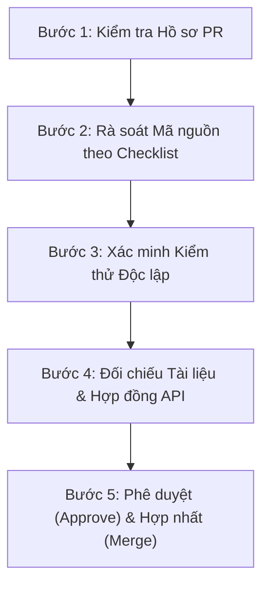

# QUY TRÌNH THẨM ĐỊNH VÀ DUYỆT PULL REQUEST (DÀNH CHO REVIEWER)

Tài liệu này quy định chi tiết trách nhiệm và các bước thực hiện của **Reviewer** khi tiếp nhận, thẩm định và phê duyệt Pull Request (PR) hợp nhất vào nhánh `develop` trong dự án **Sign Language Classification v1.0**.

Nguồn tham chiếu:
- Biểu mẫu Pull Request: [`.github/PULL_REQUEST_TEMPLATE.md`](file:///d:/file/project/Sign-Language-Classification-v1.0/.github/PULL_REQUEST_TEMPLATE.md)
- Quy trình chuẩn dự án: [`docs/WORKFLOW.md`](file:///d:/file/project/Sign-Language-Classification-v1.0/docs/WORKFLOW.md)
- Bộ nhớ & Ràng buộc kỹ thuật: [`AGENTS.md`](file:///d:/file/project/Sign-Language-Classification-v1.0/AGENTS.md)

---

## 1. Mục đích và Phạm vi Áp dụng

* **Mục đích:** Đảm bảo mọi thay đổi đưa vào nhánh `develop` đều đạt chuẩn chất lượng (Quality Gates), không làm hỏng pipeline hiện có (Regression Free), tuân thủ đúng Quy tắc nghiệp vụ (Business Rules) và có đầy đủ bằng chứng kiểm thử minh bạch.
* **Phạm vi:** Áp dụng cho toàn bộ các PR có nhánh đích là `develop` xuất phát từ các nhánh tính năng (`feature/*`), sửa lỗi (`bugfix/*`), tài liệu (`docs/*`), hoặc tối ưu mã nguồn (`refactor/*`).

---

## 2. Quy trình Thẩm định 5 Bước của Reviewer



---

### Bước 1: Kiểm tra Hồ sơ PR (PR Sanity Check)

Reviewer kiểm tra trang tổng quan của Pull Request trên giao diện GitHub:

1. **Kiểm tra Nhánh Nguồn & Nhánh Đích:**
   * **Nhánh nguồn (Compare):** Phải là nhánh phát triển tính năng tương ứng (ví dụ: `feature/US-002`).
   * **Nhánh đích (Base):** Bắt buộc phải là **`develop`** (tuyệt đối không merge trực tiếp vào `main`).
2. **Kiểm tra Định dạng Tiêu đề & Thông tin PR:**
   * Tiêu đề PR phải có mã Ticket/Story: `[US-XXX] - Mô tả ngắn gọn`.
   * Mục đích giải thích rõ ràng lý do tạo PR và liệt kê các Story ID, Rule ID liên quan (ví dụ: `US-002`, `BR-003`).
   * Đã chọn đúng **Loại thay đổi** (Feature, Bugfix, Refactor, Docs...).
   * Bảng **Thay đổi chính (Summary of Changes)** liệt kê đầy đủ các file đã sửa/thêm mới kèm mô tả ngắn gọn.
3. **Kiểm tra Bằng chứng Kiểm thử (Test Evidence) từ Tác giả:**
   * Bảng Kịch bản kiểm thử có log terminal hoặc ảnh chụp màn hình chứng minh test đã chạy.
   * Tất cả các ô trong **Checklist Tác giả (Self-review)** đã được tick chọn `[x]`.

---

### Bước 2: Rà soát Mã nguồn (Code Review theo Checklist)

Reviewer chuyển sang tab **Files changed** trên GitHub để soi từng dòng thay đổi (diff) và đối chiếu với **Checklist Người duyệt**:

| Tiêu chí Soi Mã nguồn | Yêu cầu Kỹ thuật Đạt chuẩn | Rủi ro nếu Bỏ qua |
|---|---|---|
| **1. Tuân thủ Quy tắc Nghiệp vụ (BR)** | Code phải bám sát Business Rules (ví dụ US-002: tuân thủ `BR-003`, danh sách nhãn chỉ tồn tại duy nhất tại `src/vsl/labels.py`). | Lệch dữ liệu giữa lúc huấn luyện và khi suy luận. |
| **2. Clean Code & Debug** | Không còn lệnh `print(...)` debug tạm bợ, không có comment code cũ bị bỏ đi hoặc code thừa (dead code). | Gây rác log khi chạy ứng dụng thật. |
| **3. Không hard-code Magic Number** | Không gán cứng số lớp (ví dụ: cấm dùng `23`), bắt buộc dùng biến suy luận tự động `NUM_CLASSES`. | Lỗi kích thước vector (Shape Mismatch) khi mở rộng bảng nhãn. |
| **4. Không hard-code Đường dẫn Tuyệt đối** | Tuyệt đối không phát sinh thêm đường dẫn Windows cục bộ dạng `D:\...` trong mã nguồn logic. | Gây crash ngay lập tức khi chạy trong container Linux trên Cloud Run. |
| **5. Không Lọt File Rác vào Git** | Không có các file/thư mục rác: `__pycache__/`, `.pytest_cache/`, `.venv/`, file tạm của Office `~$*.xlsx`. | Làm phình dung lượng repo và gây xung đột môi trường. |
| **6. Đầy đủ Docstring & Type Hint** | Các hàm, module, lớp mới phải có docstring giải thích tham số, giá trị trả về và type annotations. | Giảm tính bảo trì và khó khăn cho người phát triển tiếp theo. |
| **7. Không Breaking Change Ngầm** | Mọi thay đổi cấu trúc dữ liệu (như `tuple` thay cho `list`) phải đảm bảo tương thích 100% với các vị trí gọi. | Hỏng code suy luận thời gian thực mà không phát hiện kịp. |

---

### Bước 3: Xác minh Kiểm thử Độc lập (Local Verification)

Nhằm đảm bảo code không bị lỗi phụ thuộc môi trường máy tác giả, Reviewer thực hiện kéo nhánh về máy cục bộ và chạy kiểm tra độc lập tại terminal:

1. **Cập nhật và chuyển sang nhánh PR:**
   ```powershell
   git fetch origin feature/US-002
   git checkout feature/US-002
   ```

2. **Chạy toàn bộ Test Suite:**
   ```powershell
   & "D:\program\python\python.exe" -m pytest tests -v
   ```
   * **Yêu cầu bắt buộc:** Toàn bộ test suite phải đạt **100% PASSED** (màu xanh).

3. **Chạy kiểm thử Hồi quy Mô hình (Baseline Regression):**
   ```powershell
   & "D:\program\python\python.exe" -m pytest tests/test_pipeline_baseline.py -v
   ```
   * **Yêu cầu bắt buộc:** Mô hình phải nhận diện chính xác tuyệt đối **23/23 ký tự mẫu** từ tập dữ liệu tham chiếu.

---

### Bước 4: Đối chiếu Tài liệu & Hợp đồng API

Mọi User Story hoàn thành đều phải đi kèm tài liệu phản ánh đúng thực tế:

1. **Kiểm tra File Hợp đồng API (`docs/api/US-0XX.md`):**
   * Đầy đủ 17 mục theo đúng mẫu chuẩn `_TEMPLATE.md`.
   * Trạng thái tài liệu đã được ghi nhận: `ANALYSIS_READY` và `Nghiệm thu: PASS`.
   * Mã nguồn triển khai thực tế khớp 100% với chữ ký hàm, tham số và giá trị trả về được đặc tả trong tài liệu.
2. **Kiểm tra Nhật ký Thực hiện (`docs/WORKFLOW.md`):**
   * Đã có dòng bổ sung ghi nhận User Story tương ứng trong bảng **Mục 12 (Nhật ký thực hiện)**, bao gồm: Ngày, Mã US, Nhánh, File API docs, Task đã xong, Kết quả AC và xác nhận của Chủ dự án.

---

### Bước 5: Phê duyệt (Approve) & Hợp nhất (Merge vào `develop`)

Khi tất cả 4 bước trên đều đã đạt chuẩn:

1. **Đánh dấu Checklist:**
   * Reviewer tick chọn toàn bộ các ô trong mục **`## Checklist Người duyệt (Reviewer Checklist)`** trên phần nội dung hoặc bình luận review của PR.
2. **Gửi Review Phê duyệt:**
   * Nhấp chọn nút **Review changes** $\to$ Chọn **Approve**.
   * Để lại lời nhắn nhận xét nghiệm thu rõ ràng (Ví dụ: *"Đã kiểm chứng độc lập 14/14 test pass, pipeline 23/23 ký tự chính xác, mã nguồn sạch tuân thủ đúng BR-003. Chấp thuận merge!"*).
3. **Thực hiện Merge PR:**
   * Nhấp chọn nút **Merge pull request** (chọn kiểu merge theo quy định nhóm: `Squash and merge` hoặc `Create a merge commit`).
   * Điền commit message chuẩn theo định dạng Conventional Commits:
     ```text
     feat(us-002): merge US-002 vao develop
     ```
   * Nhấn **Confirm merge** để hoàn tất việc đưa tính năng vào nhánh chính `develop`.
