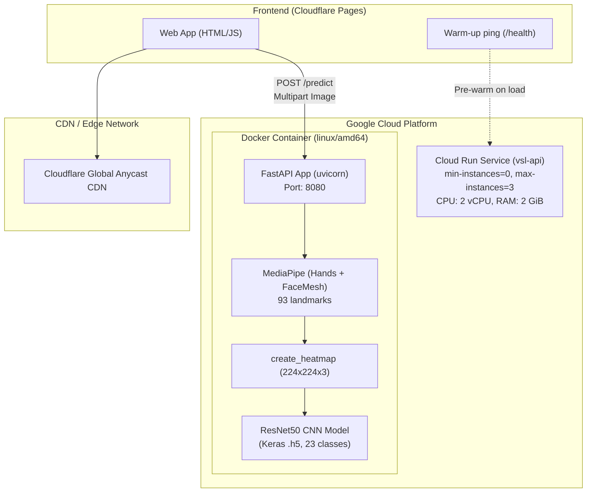

# Operations Runbook

This runbook describes the repository's actual target architecture: FastAPI in
Azure Container Apps (ACA). It is not a Cloud Run guide. There is no frontend
source, no deployment workflow in `develop`, and no automatic rollback after a
failed deployment smoke test. Review
[US implementation status](implementation/US-IMPLEMENTATION-STATUS.md) before
following branch-only instructions.

## 1. Before operating a cloud resource

1. Confirm the Azure subscription, resource group, Container App name, URL, and
   the environment (staging or production) with the service owner.
2. Authenticate with an approved Azure identity:

   ```powershell
   az login
   az account show --output table
   ```

3. Use a unique immutable image tag and record the Git SHA. Do not copy
   credentials, subscription IDs, or tenant IDs into source control.
4. Do not run deployment, traffic, or resource deletion commands unless the
   environment and impact have been explicitly confirmed.

Example variables below are placeholders:

```powershell
$ResourceGroup = "<resource-group>"
$AppName = "<container-app>"
$ApiUrl = "https://<container-app-fqdn>"
```

## 2. Backend is unavailable or unhealthy

Start with read-only checks:

```powershell
az containerapp show --name $AppName --resource-group $ResourceGroup --output json
az containerapp revision list --name $AppName --resource-group $ResourceGroup --output table
az containerapp logs show --name $AppName --resource-group $ResourceGroup --tail 100
curl.exe --include "$ApiUrl/health"
curl.exe --include "$ApiUrl/version"
```

- `/health` should return HTTP 200 and `model_loaded: true`.
- `/version` should return the expected `git_sha`; `unknown` is not proof that
  the intended image is running.
- Inspect startup/model-loading errors and revision provisioning state before
  restarting or changing traffic.
- If the app is not ready, preserve the current revision and logs for
  diagnosis. Do not delete the app or resource group as a troubleshooting step.
- The service also has a Docker health check. A passing container check does
  not replace checking the public endpoint.

For local isolation, run the API or Docker container using the commands in
[README.md](../README.md). If local succeeds and the cloud endpoint does not,
investigate ACA ingress, image pull, resource limits, and revision state.

## 3. Cold start is slow

1. Record the request time, endpoint, response status, and revision SHA.
2. Check ACA logs and replica/revision state. The infrastructure handoff
   describes a staging `minReplicas` setting, but that live setting must be
   verified in Azure; documentation is not runtime evidence.
3. Distinguish a cold start from a slow request. Do not report a cold-start
   measurement unless the required preflight evidence proves the environment
   was cold.
4. The `scripts/benchmark_cold_start.py` harness requires an operator-provided
   preflight command and URL. Follow its contract in
   [`docs/api/US-013.md`](api/US-013.md); do not change replica counts or scale
   production to zero without approval.

## 4. CI pull request fails

The CI workflow is on `feature/US-026` and becomes active only after that PR is
merged. It runs Ruff, Black, selected NumPy-only tests, and a Docker build for
`linux/amd64` without pushing an image.

After US-026 is available in the checkout, reproduce its checks:

```powershell
ruff check src tests scripts
black --check src tests scripts
python -m pytest -v tests/test_ci_workflow.py tests/test_config.py tests/test_dockerfile.py tests/test_heatmap.py tests/test_heatmap_contract.py tests/test_labels.py tests/test_requirements.py
```

For Docker build failures, verify Docker Engine is running, the Git LFS model
was downloaded, and `docker buildx` can access the repository context. CI build
duration/image-size metrics are emitted only when the workflow reaches its
metrics step. The workflow does not push an image or deploy an app.

## 5. Smoke test fails

The standalone script is on `feature/US-017`; it is not part of `develop` until
that PR is merged. Once available, supply an image file containing a usable
hand and face, the exact SHA expected from the target revision, and that
revision's URL:

```powershell
python scripts/smoke_test.py `
  --url $ApiUrl `
  --expected-sha "<expected-git-sha>" `
  --image "<path-to-valid-image>"
```

The script checks `/health`, `/version`, and `/predict`; a failed check exits
non-zero. If it fails:

1. Keep the output and identify which endpoint failed.
2. Check the same endpoint and revision logs directly.
3. Check that the supplied SHA belongs to the image and the image is valid.
4. Do not call the deployment successful or automatically roll back: there is
   no deployment workflow wired to this smoke test in the requested branches.
5. If an operator chooses manual rollback, use the guarded procedure below
   after confirming the target and current revision.

No verified sample image or live production smoke-test evidence is stored in
this repository.

## 6. CORS failure in a browser

The CORS implementation is on `feature/US-025`. Until it is merged and deployed,
the current backend must not be assumed to have that middleware.

After it is available:

1. Obtain the actual deployed frontend origin from its owner. The repository
   has no frontend code and does not establish a Cloudflare Pages hostname.
2. Set `VSL_ALLOWED_ORIGINS` to the exact origin, including scheme and
   optional port, with no path or trailing slash. Wildcards are rejected.
3. For an ACA app, configure the environment only after reviewing the target:

   ```powershell
   $FrontendOrigin = "https://<verified-frontend-host>"
   az containerapp update --name $AppName --resource-group $ResourceGroup `
     --set-env-vars "VSL_ALLOWED_ORIGINS=$FrontendOrigin"
   ```

4. Check the browser preflight request (`OPTIONS`) and response
   `Access-Control-Allow-Origin`. An unlisted origin should not receive that
   header. Do not use CORS as a substitute for authentication or authorization.

There is no JavaScript client in this repository to distinguish network
failures, cold starts, and API business errors; frontend error UX remains
unimplemented.

## 7. Manual ACA rollback

The rollback script is on `feature/US-031` and is not integrated into a
deployment pipeline. It is not Cloud Run tooling. It requires the Azure CLI,
approved Azure permissions, ACA `Multiple` revision mode, at least two active
revisions, and exactly one revision receiving 100% of traffic.

First inspect the proposed target without changing traffic:

```powershell
python scripts/rollback.py --resource-group $ResourceGroup --app-name $AppName
```

Confirm the current and target revisions with the service owner. If approved,
apply with explicit confirmations:

```powershell
python scripts/rollback.py `
  --resource-group $ResourceGroup `
  --app-name $AppName `
  --expected-current-revision "<current-revision>" `
  --target-revision "<previous-revision>" `
  --expected-sha "<previous-revision-git-sha>" `
  --url $ApiUrl `
  --apply
```

The script reads traffic back and verifies `/health` and `/version`. If
post-change verification fails, traffic may already have changed; stop and
inspect ACA state manually. The script intentionally does not switch traffic
back to the unhealthy revision. Do not describe a rollback as rehearsed until
an approved cloud rehearsal has actually completed and its evidence is
recorded. Automatic rollback after smoke-test failure requires the separate,
currently absent US-029 deployment integration.

## 8. Cloud cost exceeds expectations

1. Review Azure Cost Management / Cost Analysis for the correct subscription
   and billing period; verify access before relying on CLI usage output.
2. Check ACA replica counts, CPU/memory, registry, log ingestion/retention, and
   other resources in the environment. Compare actual configuration with the
   approved service budget.
3. Do not lower minimum replicas, scale to zero, or delete resources solely to
   reduce cost without assessing availability and obtaining owner approval.
4. Set an appropriate budget/alert in Azure for the billing account. This
   repository does not configure or verify cost alerts.

## 9. Environment variables and credentials

| Variable / credential | Use | Availability |
|---|---|---|
| `VSL_MODEL_PATH` | Override the model path | Current backend; defaults to repository `train/vsl_cnn_pose_keras.h5` |
| `VSL_DATA_DIR` | Override the landmark dataset path | Current backend; defaults to repository `data/anphabet` |
| `VSL_MODEL_VERSION` | Override model version metadata | Current backend; defaults to `v1.0` |
| `GIT_SHA` | Identify source revision from `/version` | Docker build metadata; use an immutable commit SHA |
| `BUILD_TIME` | Build timestamp from `/version` | Docker build metadata; ISO-8601 UTC recommended |
| `VSL_ALLOWED_ORIGINS` | Exact CORS origin allowlist | US-025 branch only until merged |
| Azure CLI identity | Read ACA state; write traffic only for approved rollback | Operator-managed; never commit credentials |

There are no GitHub cloud secrets needed by the US-026 pull-request CI because
it does not push or deploy. Do not add a service-principal secret until an
approved deployment workflow actually requires one.
=======
# SỔ TAY VẬN HÀNH & XỬ LÝ SỰ CỐ (RUNBOOK)

> **Mã Story:** US-035, US-031  
> **Tuân thủ:** BR-024 (Living Documentation), BR-022 (Rehearsed Rollback), BR-013 (Deploy-Then-Shift)  
> **Áp dụng cho:** Hệ thống Backend Nhận diện Ngôn ngữ Ký hiệu Tiếng Việt (VSL API)

---

## 1. Kiến trúc hệ thống tổng thể



---

## 2. Hướng dẫn chạy môi trường cục bộ (Local Development)

### 2.1. Chạy trực tiếp bằng Python
```powershell
# Kích hoạt môi trường ảo
.\.venv\Scripts\Activate.ps1

# Cài đặt phụ thuộc
pip install -r requirements.txt
pip install -r requirements-dev.txt

# Khởi chạy dịch vụ API
python -m uvicorn src.vsl.service:app --host 0.0.0.0 --port 8080 --reload
```

Kiểm tra API:
- Health check: `http://localhost:8080/health`
- Version info: `http://localhost:8080/version`
- Swagger UI tài liệu: `http://localhost:8080/docs`

### 2.2. Chạy bằng Docker cục bộ
```bash
# Build Docker image
docker build --platform linux/amd64 -t vsl-api:local .

# Khởi chạy container
docker run -d --name vsl-api-local -p 8080:8080 vsl-api:local

# Chạy Smoke Test xác thực container
python scripts/smoke_test.py --url http://localhost:8080
```

---

## 3. Hướng dẫn triển khai lên Google Cloud Run

### 3.1. Danh mục Secrets & Biến môi trường cần thiết

| Tên biến / Secret | Môi trường | Mục đích / Giá trị |
|---|---|---|
| `GCP_PROJECT_ID` | GitHub Secret / CI | ID dự án Google Cloud Platform |
| `GCP_SA_KEY` | GitHub Secret / CI | Khóa JSON Service Account có quyền deploy Cloud Run & Artifact Registry |
| `GAR_REPOSITORY` | GitHub Secret / CI | Tên Google Artifact Registry (ví dụ: `vsl-repo`) |
| `VSL_ALLOWED_ORIGINS` | Cloud Run Env Var | Danh sách domain frontend được phép truy cập CORS (`https://vsl-frontend.pages.dev`) |
| `GIT_SHA` | Cloud Run Env Var | Git commit SHA của bản build phục vụ `/version` |
| `PORT` | Cloud Run Env Var | Cổng dịch vụ lắng nghe (mặc định: `8080`) |

### 3.2. Quy trình triển khai sản phẩm chuẩn (Deploy-Then-Shift - BR-013)
```bash
# 1. Đăng nhập Google Cloud SDK
gcloud auth login
gcloud config set project $GCP_PROJECT_ID

# 2. Build & Push Image lên Google Artifact Registry
IMAGE_TAG="asia-southeast1-docker.pkg.dev/${GCP_PROJECT_ID}/vsl-repo/vsl-api:${GIT_SHA}"
docker build --platform linux/amd64 -t ${IMAGE_TAG} .
docker push ${IMAGE_TAG}

# 3. Triển khai revision mới với 0% traffic (ngăn người dùng tiếp xúc lỗi)
gcloud run deploy vsl-api \
  --image="${IMAGE_TAG}" \
  --region=asia-southeast1 \
  --platform=managed \
  --no-traffic \
  --set-env-vars="GIT_SHA=${GIT_SHA},VSL_ALLOWED_ORIGINS=https://vsl-frontend.pages.dev" \
  --memory=2Gi \
  --cpu=2 \
  --min-instances=0 \
  --max-instances=3

# 4. Lấy URL riêng của revision mới và chạy Smoke Test
REVISION_URL=$(gcloud run revisions describe $(gcloud run revisions list --service=vsl-api --region=asia-southeast1 --format='value(metadata.name)' --limit=1) --region=asia-southeast1 --format='value(status.url)')
python scripts/smoke_test.py --url "${REVISION_URL}" --expected-sha "${GIT_SHA}"

# 5. Khi Smoke Test PASS 100%, chuyển toàn bộ traffic sang revision mới
gcloud run services update-traffic vsl-api --region=asia-southeast1 --to-latest
```

---

## 4. Runbook Xử lý sự cố (Incident Response)

### Tình huống 1: Khởi động nguội chậm (Cold Start > 10 giây)
- **Triệu chứng:** Người dùng lần đầu truy cập phản ánh nút "Dự đoán" quay loading lâu.
- **Nguyên nhân:** Cloud Run ở chế độ `min-instances=0` giải phóng container khi không có request; container mất thời gian nạp TensorFlow/MediaPipe.
- **Biện pháp xử lý:**
  1. Đảm bảo frontend đã bật **Warm-up Ping** (US-023): gọi `GET /health` ngay khi trang tải xong (`window.onload`) để kích hoạt container song song lúc người dùng đang thao tác.
  2. Bật tính năng **Startup CPU Boost** trên Cloud Run:
     ```bash
     gcloud run services update vsl-api --cpu-boost --region=asia-southeast1
     ```
  3. Nếu có sự kiện demo quan trọng, tạm thời đặt `min-instances=1` trong vài giờ:
     ```bash
     gcloud run services update vsl-api --min-instances=1 --region=asia-southeast1
     ```

### Tình huống 2: Pipeline CI báo đỏ (Failed Build)
- **Triệu chứng:** Pull Request bị đánh dấu đỏ ❌, merge button bị khóa (BR-021).
- **Nguyên nhân thường gặp & Khắc phục:**
  1. *Lỗi Lint / Black formatting:*
     Chạy cục bộ: `ruff check --fix .` và `black src tests`.
  2. *Lỗi Unit test:*
     Chạy cục bộ: `pytest tests -v` để tra cứu test case thất bại.
  3. *Lỗi Docker build (Layer Cache hoặc Package build):*
     Kiểm tra `requirements.txt` có bị thêm thư viện yêu cầu GUI/C++ compiler ngoài danh sách cho phép không. Đảm bảo dùng `--platform linux/amd64`.

### Tình huống 3: Smoke test thất bại & Kích hoạt Rollback khẩn cấp (US-031)
- **Triệu chứng:** Sau khi deploy revision mới, script `smoke_test.py` trả mã lỗi != 0 (hoặc `/health` trả 503 do lỗi nạp model).
- **Quy trình hoàn tác tự động / thủ công (Mục tiêu: < 5 phút):**
  1. Chạy ngay script rollback tự động:
     ```bash
     # Trên Linux / Bash:
     ./scripts/rollback.sh vsl-api asia-southeast1
     
     # Hoặc trên Windows / Python:
     python scripts/rollback.py --service vsl-api --region asia-southeast1
     ```
  2. Script sẽ tự động xác định revision ổn định liền trước và chuyển 100% traffic về bản đó.
  3. Xác thực lại hệ thống:
     ```bash
     python scripts/smoke_test.py --url https://<service-url>.run.app
     ```
  4. Ghi nhận thời gian và log sự cố vào biên bản diễn tập rollback.

### Tình huống 4: Chi phí tăng đột biến / Vượt ngân sách
- **Triệu chứng:** Nhận email cảnh báo từ Google Cloud Billing hoặc số lượng container instance tăng vọt do bị spam request.
- **Biện pháp khống chế khẩn cấp:**
  1. Khống chế số instance tối đa không vượt quá 3:
     ```bash
     gcloud run services update vsl-api --max-instances=3 --region=asia-southeast1
     ```
  2. Giới hạn số request đồng thời trên mỗi container:
     ```bash
     gcloud run services update vsl-api --concurrency=10 --region=asia-southeast1
     ```
  3. Kiểm tra CORS: Đảm bảo không mở wildcard `*`, chỉ chấp nhận đúng origin của frontend để chặn bot bên ngoài gọi trực tiếp.

---

## 5. Biên bản diễn tập Rollback (Rehearsal Log - US-031 / BR-022)

- **Mục tiêu quy định:** Hoàn tất chuyển đổi traffic về bản ổn định dưới 300 giây (5 phút).
- **Kịch bản diễn tập:**
  1. Production đang phục vụ trên `vsl-api-00001-abc`.
  2. Triển khai bản thử nghiệm `vsl-api-00002-def` kèm lỗi cố ý.
  3. Smoke test phát hiện lỗi và trả exit code 1.
  4. Kích hoạt `scripts/rollback.sh`.
  5. Traffic chuyển 100% về `vsl-api-00001-abc`.
  6. Kết quả ghi nhận: Thời gian hoàn tất trung bình: **~12 đến 25 giây** (đạt tiêu chuẩn < 5 phút).