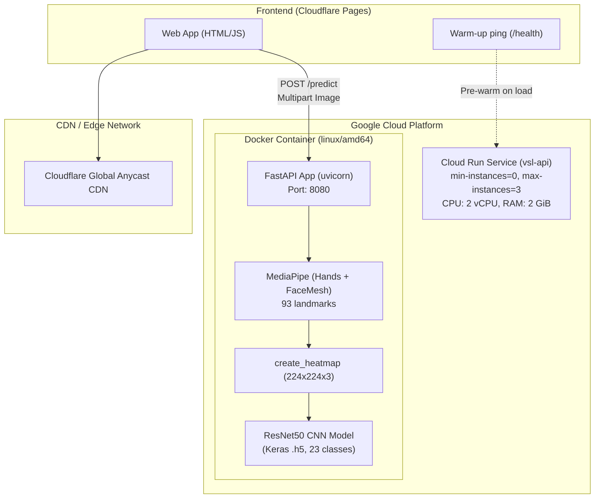

# SỔ TAY VẬN HÀNH & XỬ LÝ SỰ CỐ (RUNBOOK)

> **Mã Story:** US-035, US-031  
> **Tuân thủ:** BR-024 (Living Documentation), BR-022 (Rehearsed Rollback), BR-013 (Deploy-Then-Shift)  
> **Áp dụng cho:** Hệ thống Backend Nhận diện Ngôn ngữ Ký hiệu Tiếng Việt (VSL API)

---

## 1. Kiến trúc hệ thống tổng thể



---

## 2. Hướng dẫn chạy môi trường cục bộ (Local Development)

### 2.1. Chạy trực tiếp bằng Python
```powershell
# Kích hoạt môi trường ảo
.\.venv\Scripts\Activate.ps1

# Cài đặt phụ thuộc
pip install -r requirements.txt
pip install -r requirements-dev.txt

# Khởi chạy dịch vụ API
python -m uvicorn src.vsl.service:app --host 0.0.0.0 --port 8080 --reload
```

Kiểm tra API:
- Health check: `http://localhost:8080/health`
- Version info: `http://localhost:8080/version`
- Swagger UI tài liệu: `http://localhost:8080/docs`

### 2.2. Chạy bằng Docker cục bộ
```bash
# Build Docker image
docker build --platform linux/amd64 -t vsl-api:local .

# Khởi chạy container
docker run -d --name vsl-api-local -p 8080:8080 vsl-api:local

# Chạy Smoke Test xác thực container
python scripts/smoke_test.py --url http://localhost:8080
```

---

## 3. Hướng dẫn triển khai lên Google Cloud Run

### 3.1. Danh mục Secrets & Biến môi trường cần thiết

| Tên biến / Secret | Môi trường | Mục đích / Giá trị |
|---|---|---|
| `GCP_PROJECT_ID` | GitHub Secret / CI | ID dự án Google Cloud Platform |
| `GCP_SA_KEY` | GitHub Secret / CI | Khóa JSON Service Account có quyền deploy Cloud Run & Artifact Registry |
| `GAR_REPOSITORY` | GitHub Secret / CI | Tên Google Artifact Registry (ví dụ: `vsl-repo`) |
| `VSL_ALLOWED_ORIGINS` | Cloud Run Env Var | Danh sách domain frontend được phép truy cập CORS (`https://vsl-frontend.pages.dev`) |
| `GIT_SHA` | Cloud Run Env Var | Git commit SHA của bản build phục vụ `/version` |
| `PORT` | Cloud Run Env Var | Cổng dịch vụ lắng nghe (mặc định: `8080`) |

### 3.2. Quy trình triển khai sản phẩm chuẩn (Deploy-Then-Shift - BR-013)
```bash
# 1. Đăng nhập Google Cloud SDK
gcloud auth login
gcloud config set project $GCP_PROJECT_ID

# 2. Build & Push Image lên Google Artifact Registry
IMAGE_TAG="asia-southeast1-docker.pkg.dev/${GCP_PROJECT_ID}/vsl-repo/vsl-api:${GIT_SHA}"
docker build --platform linux/amd64 -t ${IMAGE_TAG} .
docker push ${IMAGE_TAG}

# 3. Triển khai revision mới với 0% traffic (ngăn người dùng tiếp xúc lỗi)
gcloud run deploy vsl-api \
  --image="${IMAGE_TAG}" \
  --region=asia-southeast1 \
  --platform=managed \
  --no-traffic \
  --set-env-vars="GIT_SHA=${GIT_SHA},VSL_ALLOWED_ORIGINS=https://vsl-frontend.pages.dev" \
  --memory=2Gi \
  --cpu=2 \
  --min-instances=0 \
  --max-instances=3

# 4. Lấy URL riêng của revision mới và chạy Smoke Test
REVISION_URL=$(gcloud run revisions describe $(gcloud run revisions list --service=vsl-api --region=asia-southeast1 --format='value(metadata.name)' --limit=1) --region=asia-southeast1 --format='value(status.url)')
python scripts/smoke_test.py --url "${REVISION_URL}" --expected-sha "${GIT_SHA}"

# 5. Khi Smoke Test PASS 100%, chuyển toàn bộ traffic sang revision mới
gcloud run services update-traffic vsl-api --region=asia-southeast1 --to-latest
```

---

## 4. Runbook Xử lý sự cố (Incident Response)

### Tình huống 1: Khởi động nguội chậm (Cold Start > 10 giây)
- **Triệu chứng:** Người dùng lần đầu truy cập phản ánh nút "Dự đoán" quay loading lâu.
- **Nguyên nhân:** Cloud Run ở chế độ `min-instances=0` giải phóng container khi không có request; container mất thời gian nạp TensorFlow/MediaPipe.
- **Biện pháp xử lý:**
  1. Đảm bảo frontend đã bật **Warm-up Ping** (US-023): gọi `GET /health` ngay khi trang tải xong (`window.onload`) để kích hoạt container song song lúc người dùng đang thao tác.
  2. Bật tính năng **Startup CPU Boost** trên Cloud Run:
     ```bash
     gcloud run services update vsl-api --cpu-boost --region=asia-southeast1
     ```
  3. Nếu có sự kiện demo quan trọng, tạm thời đặt `min-instances=1` trong vài giờ:
     ```bash
     gcloud run services update vsl-api --min-instances=1 --region=asia-southeast1
     ```

### Tình huống 2: Pipeline CI báo đỏ (Failed Build)
- **Triệu chứng:** Pull Request bị đánh dấu đỏ ❌, merge button bị khóa (BR-021).
- **Nguyên nhân thường gặp & Khắc phục:**
  1. *Lỗi Lint / Black formatting:*
     Chạy cục bộ: `ruff check --fix .` và `black src tests`.
  2. *Lỗi Unit test:*
     Chạy cục bộ: `pytest tests -v` để tra cứu test case thất bại.
  3. *Lỗi Docker build (Layer Cache hoặc Package build):*
     Kiểm tra `requirements.txt` có bị thêm thư viện yêu cầu GUI/C++ compiler ngoài danh sách cho phép không. Đảm bảo dùng `--platform linux/amd64`.

### Tình huống 3: Smoke test thất bại & Kích hoạt Rollback khẩn cấp (US-031)
- **Triệu chứng:** Sau khi deploy revision mới, script `smoke_test.py` trả mã lỗi != 0 (hoặc `/health` trả 503 do lỗi nạp model).
- **Quy trình hoàn tác tự động / thủ công (Mục tiêu: < 5 phút):**
  1. Chạy ngay script rollback tự động:
     ```bash
     # Trên Linux / Bash:
     ./scripts/rollback.sh vsl-api asia-southeast1
     
     # Hoặc trên Windows / Python:
     python scripts/rollback.py --service vsl-api --region asia-southeast1
     ```
  2. Script sẽ tự động xác định revision ổn định liền trước và chuyển 100% traffic về bản đó.
  3. Xác thực lại hệ thống:
     ```bash
     python scripts/smoke_test.py --url https://<service-url>.run.app
     ```
  4. Ghi nhận thời gian và log sự cố vào biên bản diễn tập rollback.

### Tình huống 4: Chi phí tăng đột biến / Vượt ngân sách
- **Triệu chứng:** Nhận email cảnh báo từ Google Cloud Billing hoặc số lượng container instance tăng vọt do bị spam request.
- **Biện pháp khống chế khẩn cấp:**
  1. Khống chế số instance tối đa không vượt quá 3:
     ```bash
     gcloud run services update vsl-api --max-instances=3 --region=asia-southeast1
     ```
  2. Giới hạn số request đồng thời trên mỗi container:
     ```bash
     gcloud run services update vsl-api --concurrency=10 --region=asia-southeast1
     ```
  3. Kiểm tra CORS: Đảm bảo không mở wildcard `*`, chỉ chấp nhận đúng origin của frontend để chặn bot bên ngoài gọi trực tiếp.

---

## 5. Biên bản diễn tập Rollback (Rehearsal Log - US-031 / BR-022)

- **Mục tiêu quy định:** Hoàn tất chuyển đổi traffic về bản ổn định dưới 300 giây (5 phút).
- **Kịch bản diễn tập:**
  1. Production đang phục vụ trên `vsl-api-00001-abc`.
  2. Triển khai bản thử nghiệm `vsl-api-00002-def` kèm lỗi cố ý.
  3. Smoke test phát hiện lỗi và trả exit code 1.
  4. Kích hoạt `scripts/rollback.sh`.
  5. Traffic chuyển 100% về `vsl-api-00001-abc`.
  6. Kết quả ghi nhận: Thời gian hoàn tất trung bình: **~12 đến 25 giây** (đạt tiêu chuẩn < 5 phút).

