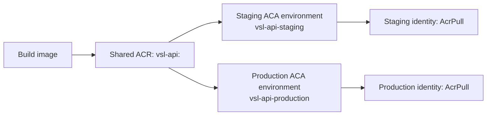

# US-021: Tách môi trường staging và production

## Kiến trúc

Staging và production chạy trong hai Azure Container Apps environments và hai
Container Apps riêng. Cả hai kéo image từ Azure Container Registry (ACR)
`vslacr3795`, được quản lý trong
Terraform root `infra/` theo US-019. Mỗi môi trường có Terraform root và Azure
Blob state riêng; không tạo một bản sao ACR cho production.



| Tham số | Staging | Production |
|---|---|---|
| Terraform root/state | `infra/environments/staging` / `staging.tfstate` | `infra/environments/production` / `production.tfstate` |
| Container App Environment | `cae-vsl-staging` | `cae-vsl-production` |
| Container App | `vsl-api-staging` | `vsl-api-production` |
| ACR | `vslacr3795` (dùng chung) | `vslacr3795` (dùng chung) |
| Image tag | Bản đã publish, pin bằng biến | Bản đã publish, pin bằng biến |
| CPU / memory | `0.5` / `1Gi` | `1` / `2Gi` |
| Min / max replicas | `0` / `3` | `1` / `10` |
| `LOG_LEVEL` | `INFO` | `WARNING` |

Module [`infra/modules/container_app`](../../infra/modules/container_app) tạo
ACA environment, service, tag tài nguyên và User Assigned Managed Identity.
Identity chỉ được cấp `AcrPull` trên ACR dùng chung. Container App dùng identity
này để kéo image; không bật ACR admin credentials. Log được gửi qua Azure Monitor.
Các root mới tạo service `vsl-api-staging` và `vsl-api-production` độc lập; ứng
dụng `vsl-api` hiện hữu do root `infra/` quản lý không bị import, thay thế hay
chỉnh sửa bởi các state này.

Trước khi apply, resource group phải tồn tại, image tag phải được publish lên
ACR, và các resource provider `Microsoft.App`, `Microsoft.ManagedIdentity` và
`Microsoft.Authorization` phải được đăng ký. Tài khoản triển khai cần quyền tạo
ACA resources, user-assigned identities và role assignment `AcrPull` trên ACR.
Nếu registry ở subscription khác, cấu hình provider alias `registry` bằng
subscription có ACR và bảo đảm identity nằm trong cùng Entra tenant.

## Luồng phát hành image

1. Build và publish `vsl-api:<tag>` lên ACR dùng chung bằng pipeline đã được cấp
   quyền push.
2. Cập nhật `image_tag` trong tfvars của staging và chạy plan/review/apply ở
   staging.
3. Kiểm tra smoke test của staging.
4. Sau phê duyệt phát hành, đặt cùng image tag đã kiểm tra vào production
   tfvars rồi chạy plan/review/apply production.

Không dùng `latest` cho production; image tag phải xác định và có sẵn trong ACR
trước khi áp dụng Terraform.

## Cấu hình và state

Sao chép file ví dụ thành tfvars cục bộ rồi điền subscription, resource group,
region, image tag và các giá trị đã xác minh:

```powershell
Copy-Item infra/environments/staging/staging.tfvars.example infra/environments/staging/staging.tfvars
Copy-Item infra/environments/production/production.tfvars.example infra/environments/production/production.tfvars
```

Hai tfvars cục bộ đã được loại khỏi Git. Chúng không chứa credentials; các
biến môi trường trong đó chỉ dành cho cấu hình không bí mật. Bí mật ứng dụng
phải được lấy từ Azure Key Vault bằng tham chiếu managed identity, không đặt
trong tfvars, `environment_variables`, hay Terraform source.
Terraform provider xác thực qua Azure CLI/OIDC; không lưu client secret trong
repository hoặc state configuration.

Khởi tạo mỗi root với Azure Blob backend đã được bootstrap theo
[`infra/README.md`](../../infra/README.md). Dùng cùng state Storage Account và
container, nhưng `key` phải khác nhau:

```powershell
terraform -chdir=infra/environments/staging init `
  -backend-config="resource_group_name=<state-resource-group>" `
  -backend-config="storage_account_name=<state-storage-account>" `
  -backend-config="container_name=<state-container>" `
  -backend-config="key=sign-language-classification/staging.tfstate" `
  -backend-config="use_azuread_auth=true" `
  -backend-config="use_cli=true"

terraform -chdir=infra/environments/production init `
  -backend-config="resource_group_name=<state-resource-group>" `
  -backend-config="storage_account_name=<state-storage-account>" `
  -backend-config="container_name=<state-container>" `
  -backend-config="key=sign-language-classification/production.tfstate" `
  -backend-config="use_azuread_auth=true" `
  -backend-config="use_cli=true"
```

Chạy validate và plan riêng cho từng môi trường:

```powershell
terraform -chdir=infra/environments/staging validate
terraform -chdir=infra/environments/staging plan -var-file=staging.tfvars

terraform -chdir=infra/environments/production validate
terraform -chdir=infra/environments/production plan -var-file=production.tfvars
```

CI chạy `terraform fmt -check` và validate cả hai root không cần credentials
Azure. Plan/apply cần đăng nhập Azure và các quyền quản trị phù hợp. Không chạy
`terraform apply` cho tới khi plan được review và được chủ dự án phê duyệt.
