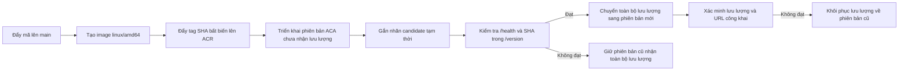

# US-029: Triển khai backend và chuyển lưu lượng an toàn

## Mô tả Pull Request (có thể sao chép)

**Mục đích:** Tự động triển khai backend lên Azure Container Apps staging theo
luồng blue-green: chỉ chuyển lưu lượng sau khi phiên bản mới vượt qua kiểm thử
khói.

**Thay đổi chính:**
- Thêm quy trình GitHub Actions chạy khi có mã mới được đẩy lên nhánh `main`;
  xác thực với Azure bằng OIDC, tạo Docker image và đẩy lên ACR với tag là Git SHA.
- Triển khai phiên bản ACA mới nhưng chưa nhận lưu lượng; kiểm tra `/health` và
  `/version`, sau đó mới chuyển toàn bộ lưu lượng sang phiên bản mới.
- Tự động chuyển lưu lượng về phiên bản trước nếu bước chuyển lưu lượng hoặc kiểm
  tra sau triển khai thất bại.
- Hỗ trợ kiểm tra `/health` và `/version` mà không cần ảnh; vẫn kiểm tra
  `/predict` nếu truyền tham số `--image`.
- Thêm federated credential tùy chọn bằng Terraform cho nhánh GitHub `main`;
  cập nhật các tài liệu vận hành liên quan.

**Kiểm thử:** `pytest tests` — đạt 158/158; Ruff, Black và Terraform
`fmt -check`/`validate` đều đạt.

**Lưu ý triển khai:** Chưa xác minh trên Azure thực tế. Trước lần chạy đầu,
cần áp dụng FIC cho nhánh `main`, cấu hình các biến GitHub Actions và xác nhận
đúng ACR cùng quyền `AcrPush`.

---

**API công khai:** Không áp dụng — thay đổi chỉ liên quan đến CI/CD, Terraform
và CLI kiểm thử khói.

## Phạm vi và môi trường đích

Quy trình `.github/workflows/deploy-backend.yml` chạy khi có mã mới được đẩy
lên nhánh `main` và triển khai vào **ứng dụng staging trên Azure Container
Apps** theo tài liệu hiện có. Phạm vi này phù hợp với kiến trúc dự án và danh
tính triển khai staging hiện tại. Quy trình không triển khai production; môi
trường production trong US-021 được tách riêng và cần được cấp phát, phê duyệt
độc lập.

Quy trình xác thực bằng GitHub OpenID Connect (OIDC), tạo image
`vsl-api:<full-git-sha>` và đẩy image lên Azure Container Registry (ACR) đã
cấu hình. Quy trình không sử dụng client secret, mật khẩu service principal, thông
tin đăng nhập quản trị ACR hoặc tệp chứa thông tin xác thực dài hạn.

## Luồng triển khai blue-green

GitHub Actions tuần tự hóa các lần triển khai. Trước khi triển khai, quy trình
chuyển ứng dụng sang chế độ nhiều phiên bản và yêu cầu chỉ có đúng một phiên bản
đang hoạt động nhận toàn bộ lưu lượng. Phiên bản mới được triển khai với
`--no-traffic`; nhãn `candidate` tạm thời tạo URL riêng để kiểm tra mức độ sẵn
sàng. Tập lệnh `scripts/smoke_test.py` xác minh `/health` trả về
`model_loaded=true` và `/version` trả về Git SHA của lần chạy quy trình. Kiểm
thử khói không bắt buộc có ảnh dự đoán; nếu truyền `--image`, CLI sẽ kiểm tra
thêm `/predict`.

Chỉ sau khi phiên bản mới vượt qua kiểm tra, quy trình mới chuyển toàn bộ lưu
lượng sang phiên bản đó và xác minh URL chính của dịch vụ. Nếu kiểm thử khói
thất bại trước khi chuyển lưu lượng, phiên bản trước tiếp tục nhận toàn bộ lưu
lượng và quy trình báo lỗi. Nếu thao tác chuyển lưu lượng hoặc bước xác minh
sau đó thất bại, quy trình khôi phục toàn bộ lưu lượng về phiên bản trước và
đặt lưu lượng của phiên bản mới về 0%. Phiên bản mới bị lỗi được giữ lại để
điều tra, không tự động vô hiệu hóa.

## Các biến GitHub Actions cần cấu hình

Cấu hình các biến cấp kho mã nguồn sau trước khi bật triển khai:

| Biến | Giá trị |
|---|---|
| `AZURE_CLIENT_ID` | Client ID từ đầu ra Terraform `github_oidc_client_id` |
| `AZURE_TENANT_ID` | Tenant ID từ đầu ra Terraform `github_oidc_tenant_id` |
| `AZURE_SUBSCRIPTION_ID` | Subscription ID từ đầu ra Terraform `github_oidc_subscription_id` |
| `AZURE_RESOURCE_GROUP` | Nhóm tài nguyên staging đã xác minh (tài liệu ghi `rg-vsl-staging`) |
| `AZURE_CONTAINER_APP_NAME` | Ứng dụng staging đã xác minh (tài liệu ghi `vsl-api`) |
| `AZURE_ACR_NAME` | Tên registry thực tế, khớp với quyền `AcrPush` và nguồn image của ứng dụng |

Đây là các giá trị định danh, không phải thông tin xác thực. Quy trình dừng
trước khi triển khai nếu thiếu bất kỳ biến bắt buộc nào. Tên registry trong
một số tài liệu bàn giao cũ không khớp với tất cả thông tin ghi nhận về tài
nguyên thực tế; hãy xác minh ACR đang dùng và quyền `AcrPush` trước khi cấu
hình `AZURE_ACR_NAME`.

## Điều kiện tiên quyết về OIDC và hạ tầng

`infra/identity.tf` giữ nguyên cấu hình tin cậy nhánh `develop` đang được
quy trình kiểm tra OIDC thủ công sử dụng, đồng thời bổ sung federated credential
tùy chọn, chỉ tin cậy chính xác nhánh `main`. Tệp
`infra/environments/staging.tfvars` khai báo subject của kho mã nguồn cho nhánh
`main`. Cần lập kế hoạch, xem xét thay đổi Terraform và áp dụng theo quy trình
Azure đã được phê duyệt trước khi quy trình trên `main` có thể xác thực. Danh tính
triển khai chỉ nên có quyền `AcrPush` trên ACR và `Container Apps Contributor`
trên ứng dụng staging.

Container App đích phải bật cổng truy cập (ingress) và hỗ trợ chế độ nhiều phiên bản hoạt
động. Các bước trong quy trình không thay đổi secret hay cấu hình ứng dụng.
Quá trình triển khai sử dụng cấu hình khi chạy hiện có của ứng dụng và chỉ
thay đổi phiên bản image cùng tỷ lệ phân phối lưu lượng.

## Phạm vi kiểm chứng và vận hành

CI kiểm tra hợp đồng quy trình, hành vi kiểm thử khói và cú pháp Terraform. Thay
đổi này chưa chạy `terraform apply`, chưa triển khai lên Azure thực tế và chưa
diễn tập rollback trên Azure. Cần có quyền truy cập tenant cùng thông tin xác
thực Azure phù hợp để kiểm tra các thao tác đó. Sau lần triển khai đầu tiên
được cấp phép, hãy xem kết quả GitHub Actions và cấu hình phân phối lưu lượng
giữa các phiên bản trên Azure.
