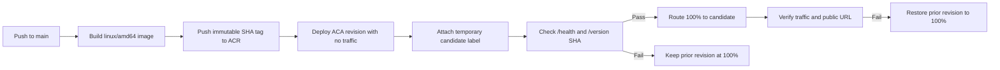

# US-029: Deploy backend revisions with safe traffic promotion

## Scope and target

`.github/workflows/deploy-backend.yml` runs on pushes to `main` and deploys to
the documented **Azure Container Apps staging app**. This follows the current
project architecture and the existing staging deployment identity. It does not
deploy to production: the production environment in US-021 is separate and must
be provisioned and approved independently.

The workflow authenticates with GitHub OpenID Connect (OIDC), builds
`vsl-api:<full-git-sha>`, and pushes it to the configured Azure Container
Registry (ACR). It never uses a client secret, service-principal password,
ACR admin credentials, or a long-lived credential file.

## Blue-green deployment flow

GitHub Actions serializes deployments. Before deploying, the job switches the
app to multiple-revision mode and requires exactly one active revision to
receive 100% traffic. The new revision is deployed with `--no-traffic`; a
temporary `candidate` label provides a revision-specific URL for readiness
checks. `scripts/smoke_test.py` verifies `/health` reports
`model_loaded=true` and `/version` reports the triggering Git SHA. A valid
prediction image is optional for this deployment smoke test; when `--image` is
provided, the CLI also checks `/predict`.

Only after candidate checks pass does the workflow assign 100% traffic to the
candidate and verify the main service URL. If smoke tests fail before promotion,
the prior revision remains at 100% and the workflow fails. If promotion or
post-promotion verification fails, the workflow explicitly restores 100% to the
previous revision and sets the candidate to 0%. A failed candidate is retained
for diagnosis rather than automatically deactivated.

## Required GitHub Actions variables

Configure these repository variables before enabling deployments:

| Variable | Value |
|---|---|
| `AZURE_CLIENT_ID` | Client ID from Terraform output `github_oidc_client_id` |
| `AZURE_TENANT_ID` | Tenant ID from Terraform output `github_oidc_tenant_id` |
| `AZURE_SUBSCRIPTION_ID` | Subscription ID from Terraform output `github_oidc_subscription_id` |
| `AZURE_RESOURCE_GROUP` | Verified staging resource group (documented as `rg-vsl-staging`) |
| `AZURE_CONTAINER_APP_NAME` | Verified staging app (documented as `vsl-api`) |
| `AZURE_ACR_NAME` | Actual registry name matching the `AcrPush` assignment and app image source |

These are identifiers, not credentials. The workflow fails before deployment
when a required variable is empty. The registry name in older handoff documents
does not match every recorded live reference; verify the actual ACR and its
`AcrPush` role assignment before configuring `AZURE_ACR_NAME`.

## OIDC and infrastructure prerequisites

`infra/identity.tf` retains the existing `develop` trust used by the manual
OIDC smoke workflow and adds an optional exact `main` branch federated
credential. `infra/environments/staging.tfvars` declares the repository's main
branch subject. Plan and review the Terraform change, then apply it through the
approved Azure process before the main-branch workflow can authenticate. The
deployer identity must have only the existing `AcrPush` scope on ACR and
`Container Apps Contributor` scope on the staging app.

The target Container App must have ingress enabled and support multiple active
revisions. Workflow actions never change application secrets or configuration.
The deployment uses the app's existing runtime settings and changes only its
image revision and traffic weights.

## Validation and operational boundaries

CI checks the workflow contract, smoke-test behavior, and Terraform syntax.
`terraform apply`, a live Azure deployment, and a live rollback rehearsal are
not run by this change. Azure credentials and tenant access are required to
validate those operations. Review the GitHub Actions run and Azure revision
traffic configuration after the first authorized deployment.
